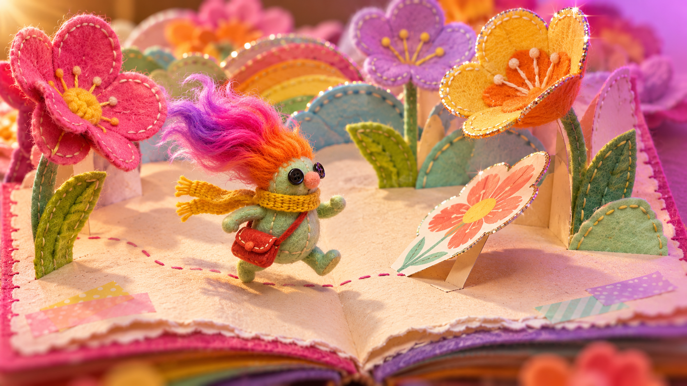

# Pop-up Atlas: Troll Edition

A small browser toy. A felt troll walks across an endless pop-up scrapbook made of felt and paper. Flowers, mushroom houses, cupcake trees and yarn bridges fold up out of the page as the troll gets close. They wobble into place, then fold flat again once it has passed. Each fold makes a soft pop. Fold-ups also ring a chime, so walking plays a little tune. Stand still for a few seconds and the troll dances.



## Play it

You need [Node.js](https://nodejs.org/) 20.19+ or 22.12+, and a recent desktop browser with WebGL 2. It was tested in Chrome.

```bash
npm install
npm run build
npm run preview
```

Then open http://localhost:4173.

For a quick local session with hot reload instead, run `npm run dev` and open the address it prints.

## Controls

| Do this | To |
|---|---|
| WASD or arrow keys | Walk |
| Click on the page | Walk to that spot. Any key cancels it |
| Stop for 4 seconds | Watch the troll dance |

There is no on-screen UI. Sound starts after your first click or key press, because browsers don't play audio until you interact with the page. The troll can't swim, so cross rivers on the yarn bridges.

## Options

Add these to the URL, for example `http://localhost:4173/?seed=42`:

| Option | What it does |
|---|---|
| `?seed=<n>` | Builds a different world. The same seed always gives the same world |
| `?debug` | Shows the frame time |
| `?cam=<distance>,<pitch>` | Moves the camera, e.g. `?cam=14,50` (pitch in degrees) |
| `?focus=<x>,<z>` | Sets where the blur is sharp |

## Hosting it

`npm run build` writes a static site to `dist/`. It uses relative paths, so you can copy the folder to any static host or subfolder. It won't run from a `file://` URL, so serve it over HTTP.

## Known limits

- Tested only on an Apple M5 Pro MacBook, where it holds 60 fps with room to spare. It hasn't been tested on a mid-range laptop.
- Folds trigger close to the troll, so a slow walk plays a sparse tune.

## More

- How it was made, scores from the blind critic rounds, and the 30-second gameplay video: [deliverables/README.md](deliverables/README.md)
- Every design target (sizes, timings, colours, audio key): [docs/contracts.md](docs/contracts.md)
- Reference image licences: [reference/LICENSES.md](reference/LICENSES.md)
