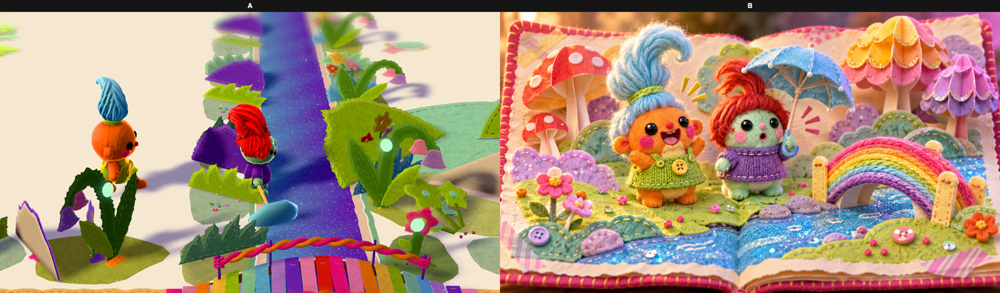
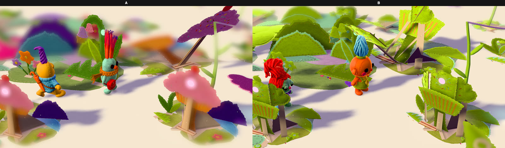
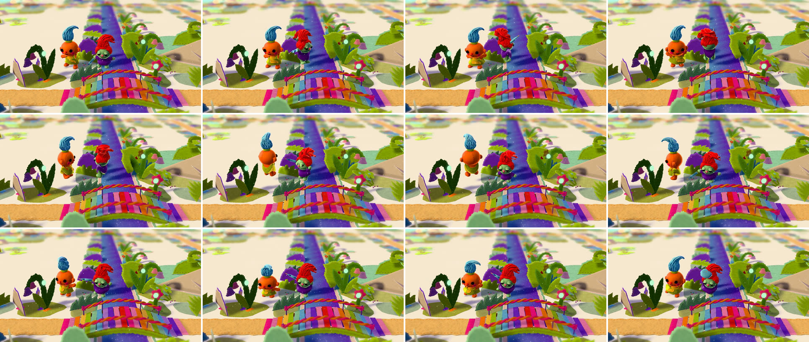
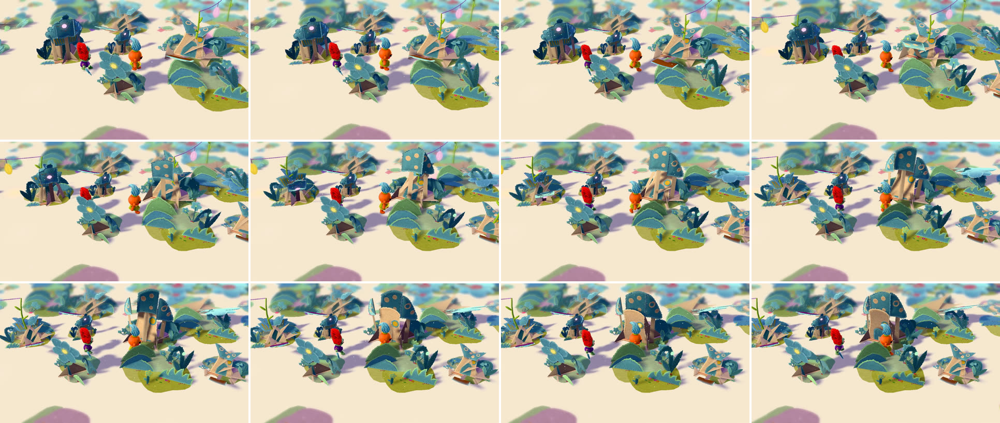

# Critic review: round-6 build

- Date: 2026-11-24.
- Build: round-6 candidate 2273401 (v0.2.0), merged to `main` at 5fad202. The look critic judged 9f02815, and the motion critic judged 9f02815 (round 1) and 4e391d5 (round 2). Between those commits and 2273401 only gate scripts, tests, the changelog and the log changed, except for the motion fix described below.
- Critics: blind, read-only `deep_reasoner` jobs (Codex), one scratch repository per job holding only anonymised images. The answer keys stayed in `deliverables/round-6/key/`. Sound was judged locally by MOSS (`audio/listen.py ab`).
- Readers: the project owner, and the agents that implement the follow-up round.

## Result

| Axis | Pass bar (goal "Critic criteria") | Result | Pass |
|---|---|---|---|
| Look, concept pairs | concept picked at most 3 of 4, game mean at least 6/10 | concept picked 4 of 4 at 100 % confidence, game mean 4.75 | no |
| Look, round 5 against round 6 | round 6 preferred in at least 5 of 6 | round 6 preferred in 2 of 6 | no |
| Motion axes | every axis at least 7/10 | fold 8, lead walk 7, companion walk 6, dance 8, hair 7, faces 6, squash 5 (round 2) | no |
| Motion, round 5 against round 6 | round 6 preferred in at least 4 of 6 | 5 of 6 (round 1: 4 of 6) | yes |
| Motion fix against the preceding candidate | fix not worse (revert rule) | fix preferred in 5 of 6, 1 no preference | kept |
| Sound, round-5 voices against round-6 voices | new preferred in at least 4 of 6, mix check passes | new 1, old 2, tie 3; mix passes; provisional | no, provisional |

Both allowed critic rounds were used. The owner decided at U6 (`docs/log.md`, 2026-11-24). The merge is approved and the round-6 voices stay. A follow-up round covers foreground props and light, and the unmet targets are recorded as exceptions.

## Look

### Inputs
- Four blind pairs: each concept frame in `reference/concept-r6/` (duo walk, duo dance, umbrella pop, hero fold) beside the game at the same moment, staged by `scripts/sbs.mjs`. The sides were shuffled.
- Six blind pairs: the round-5 build (fa6d96b, served on a second port) beside the round-6 build at the same pose.

### Concept pairs
The critic found the concept side in all four pairs at 100 % confidence. Scores out of 10 for handmade feel, composition, character appeal and charm:

| Pair | Moment | Concept | Game | Game wows? |
|---|---|---|---|---|
| concept-01 | umbrella pop | 10 / 9 / 10 / 10 | 5 / 5 / 5 / 5 | no |
| concept-02 | hero fold | 9 / 9 / 9 / 9 | 4 / 4 / 4 / 4 | no |
| concept-03 | duo walk | 10 / 9 / 10 / 9 | 5 / 5 / 4 / 4 | no |
| concept-04 | duo dance | 10 / 9 / 10 / 10 | 5 / 5 / 7 / 5 | no |

Game mean: 4.75. Earlier rounds, each against its own concept frames: round 3 3.3, round 4 4.0, round 5 5.13.

### Round 5 against round 6
The key maps the critic's picks to round 6 in 2 of 6 pairs. The decisive difference the critic named in each pair:

| Shot | Preferred | Decisive difference |
|---|---|---|
| dance | round 6 | In round 5 a foreground flower hides the lead's face. |
| umbrella | round 6 | The rainbow bridge stays in focus, with its rail and slats readable. |
| bridge | round 5 | The stronger background blur makes the creatures and the bridge the focal point. |
| fold-up | round 5 | More of the round-5 companion's face shows above the foreground felt. |
| walk | round 5 | The purple canopy breaks up the green palette around the creatures. |
| hero fold | round 5 | Both silhouettes have room; in round 6 a foreground prop hides much of the companion. |

### Diagnosis (critic, turn 2)
1. **Frame the two creatures closer and lower.** In the hero-fold and walk pairs the view is high and distant. The creatures are small, and foliage hides parts of their faces. Use a closer three-quarter view that keeps both faces and silhouettes clear.
2. **Give the scrapbook visible layers and texture.** In the hero-fold, walk and dance pairs, broad cream areas read as a flat surface. Show the gutter and stacked page edges, and give felt banks and leaves fuzzy cut edges and raised stitches.
3. **Use softer, warmer light.** Long purple shadows and bright lime foliage dominate several frames. A broad, warm light with soft shadows under the feet and paper folds would seat the figures and props on the page.

### Reading
- Three of the six decisive differences are props in front of a face. Round 6 made the props larger (appliqué, domes) and brought the camera closer. Props between the camera and the pair now cover the creatures more often.
- One difference is the tilt-shift. Round 6 widened the sharp band and reduced the blur, after the owner called the round-4 stage "mushy". The critic preferred the stronger blur.
- One difference is colour. The zone families give a grove one prop colour family, so a lime grove reads all green.
- The owner chose a follow-up on the first and third items: fewer props in front of the faces, and softer, warmer light. The camera and the blur stay as they are.

## Motion

### Inputs
- Eight burst sheets from the round-6 capture at 8 frames a second, 12 frames each: lead walk, fold-up, swap, companion leads, river, dance start, dance turn, dance bow.
- Six blind pairs, made by `scripts/motion-pairs.mjs`: the round-5 and round-6 captures at matched moments, as 8-frame bursts.
- For the revert rule, six more blind pairs in a separate job: the preceding candidate (9f02815) against the fix (4e391d5) on the same route.

### Round 1 (9f02815)
| Axis | Score | Evidence (critic) |
|---|---|---|
| Fold | 8 | The front flap dips, the roof springs upright, and the door swings into place a beat later. |
| Lead walk | 7 | Clear forward steps with a perky head bob and light footfalls. |
| Companion walk | 7 | Short steps and a low umbrella swing give a guarded gait. |
| Duo dance | 8 | The companion starts its hopping turn and the lead picks up the move, so the offset reads as choreography. |
| Hair | 8 | The red tuft fans out through the spin; the blue tuft bunches on landing and curls back up. |
| Faces | 6 | The lead's blink reads, but both mouths hold nearly the same shape through the bow. |
| Squash and stretch | 5 | The lead dips and rebounds after its hop, with only a slight change in torso shape. |

Round 6 was preferred over round 5 in 4 of 6 pairs (one no preference).

### Diagnosis (critic, turn 2)
- **Faces, for 8/10:** the lead's closed smile opens into a crescent as it prepares to hop, then softens after the bow. The companion purses its mouth at the riverbank and lifts one corner into a reluctant smile as it lowers the umbrella. Both shapes must be distinguishable at dance-sheet scale.
- **Squash, for 8/10:** on a hop landing the torso lengthens about 4 % just before contact. At the lowest point it shortens 10-12 % and widens 5-7 %, with the feet planted. Walking steps compress the torso 3-5 % as each foot takes weight, with the head shape steady.

### Fix (4e391d5)
- The squash amplitudes already matched the request: the dance landing shortens 12 % and widens 6.6 %, and steps compress 5 %. The spring (ω 18, ζ 0.5) returned in about 0.1 s, so the squash rarely showed in a burst.
- The spring is now ω 11, ζ 0.6. A 1.04 stretch comes 0.1 s before the dance landing.
- During the duo dance, the follower now shows the leader's dance mouth shapes one canon delay (0.3125 s) later. Before the fix the follower always showed its rest shape.
- The contract, unit tests and e2e gate moved with the fix (`docs/log.md`, E6a fix round 2).

### Round 2 (4e391d5, fresh blind session)
| Axis | Round 1 | Round 2 | Evidence (critic, round 2) |
|---|---|---|---|
| Fold | 8 | 8 | The flap dips, the spotted roof springs upright, and the side panels keep moving before they settle. |
| Lead walk | 7 | 7 | Clear reaches with a buoyant bounce, though each foot plant is brief. |
| Companion walk | 7 | 6 | Short, upright steps with little visible weight shift. |
| Duo dance | 8 | 8 | The turns read as a shared phrase. |
| Hair | 8 | 7 | The blue crest curls down and springs tall again; the red crest stays compact through the walk. |
| Faces | 6 | 6 | The lead's smile, the companion's heavy lids and the blink read; the mouths barely change. |
| Squash and stretch | 5 | 5 | The lead dips on landing and rebounds, but the torso compresses only slightly. |

- Axis mean 6.71 against 7.00 in round 1: a drop of 0.29, under the 0.5 revert line. The two rounds ran in different sessions.
- Round 6 was preferred over round 5 in 5 of 6 pairs.
- In the fix pairs the fix was preferred in 5 of 6, with 1 no preference. The critic named the fix's effects without being told what changed: the lead "starts in a squash", its "smile opens wider as it hops into the turn", and the companion "compresses slightly ... then stretches back up". The fix stays.

### Reading
- Faces and squash stay below 7 after both rounds. At the walk and dance cameras the mouth patch spans only a few pixels in a burst frame. Mouth shapes are hard to see there at any timing. A larger mouth patch would need new character models.
- The companion's walk dropped from 7 to 6 between sessions. Its code and clip did not change between the two rounds.

## Sound
- MOSS's paired-input probe failed, so `listen.py ab` scored each clip alone. Ratings sat at 9-10 and two items were flagged insensitive.
- Mapped through the keys: new voices preferred in 1 pair (the companion's swap line), old voices in 2 (the companion's hum, the bridge), tie in 3.
- The mix check passed: voice peaks 3.54 dB above chime peaks, steps 20 dB and chorus 10 dB under the voice, no clipping.
- The verdict stayed provisional. The owner listened to the six pairs on the review page and kept the round-6 voices.

## Follow-ups
- Look, chosen by the owner: fewer props in front of the creatures' faces, and softer, warmer light. The camera and the blur stay.
- Motion, open: mouth shapes readable at the game's cameras, companion walk weight. Both need more than timing changes.
- Measured targets the owner accepted at U6, not raised by the critics: load time (fix: shared shader programs), the hum-route overlap, the lantern count and the hero-prop rim.

## Sources
- Verdicts: `deliverables/round-6/verdicts/` (local, gitignored): `C6-look-r1.md`, `C6-motion-r1.md`, `C6-motion-r2.md`, `C6-sound-r1.md`, `C6-sound-moss.json/`.
- Keys: `deliverables/round-6/key/` and `deliverables/round-6/critic-round1/key/`.
- Jobs: `.handoff/jobs/*C6*`.
- Decision record: `docs/log.md`, 2026-11-24 entries.
